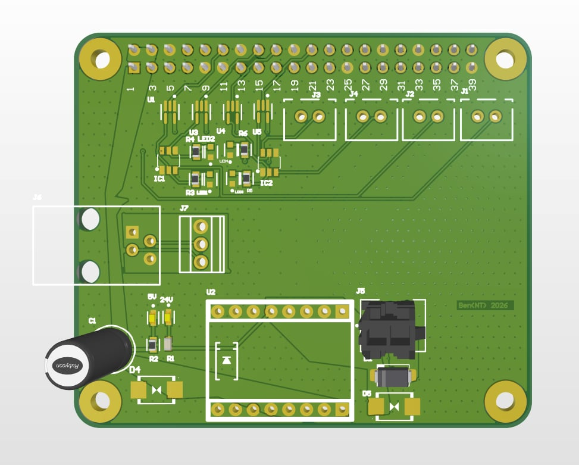
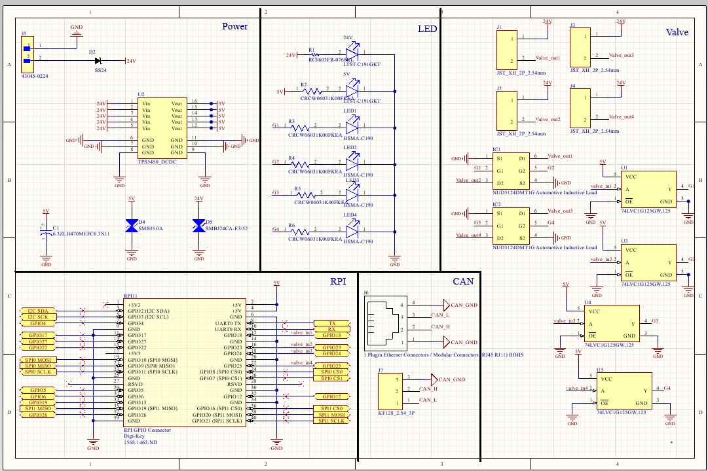

# Robocon-PCB
Custom pneumatic control PCB developed for the HKU Robocon Mini Contest

---

##  Key Features
 - **Embedded Platform**: Raspberry Pi
 - **Power Input**: 24V DC
 - **Communication**: CAN Bus Interface
 - **Actuation**: 4-Channel Pneumatic Valve Control
 - **Diagnostics**: Status LEDs

---

##  PCB Render & Schematic

### PCB Render

### Schematic

---

##  Tools & Technologies Used
- Altium Designer
- Raspberry Pi
- CAN Bus
- PCB Design & Electronics Testing
